# Labo AD, partie 2 : gérer une vraie entreprise avec PowerShell

🇬🇧 [English version](README.md)
⬅️ [Retour à la partie 1 : construction du labo](../README.md)

La partie 1 a bâti le labo : domaine **lab.local**, contrôleur de domaine **DC01** (Windows Server 2022) et poste client **PC01** (Windows 11).
La partie 2 le gère comme un vrai service informatique. Chaque changement vient d'un **billet**, se fait dans **PowerShell**, puis est **prouvé dans le journal Sécurité de Windows**. Les prochaines missions envoient ces journaux dans **Splunk**.

| Mission | Billet | Compétences | État |
|---|---|---|---|
| 1 | REQ-5001 : nouveau service Finances | UO, groupe de sécurité, utilisateur, appartenance à un groupe, stratégie d'audit, événements 4720 / 4727 / 4728 | ✅ Terminée |
| 2 | À venir | Événements d'activation et de modification de compte (4722, 4738), Observateur d'événements | ⏳ |
| 3 | À venir | Splunk Universal Forwarder sur DC01 | ⏳ |

---

## Mission 1 : REQ-5001, nouveau service Finances

> **Billet (des RH) :** « Nous ouvrons un service Finances. Créez une UO Finance et un groupe Finance Team, et créez le compte de notre nouvelle employée, Sofia Martin (smartin), avec l'accès Finances. »

### Étape 1 : vérifier que le DC enregistre les changements de comptes

Avant de changer quoi que ce soit, je me suis assuré que Windows écrit ces changements dans le journal Sécurité. Sans audit, il n'y a rien à enquêter plus tard.

```powershell
auditpol /get /category:"Account Management"
```
*Affiche quels changements de comptes sont enregistrés (Success / Failure / No Auditing).*

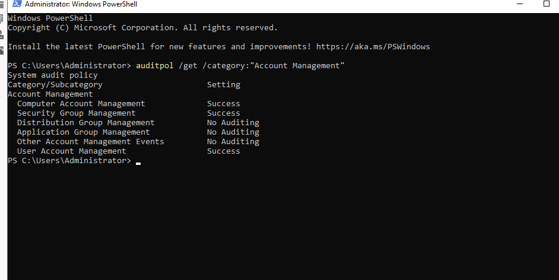

**Résultat :** **User Account Management** et **Security Group Management** sont tous les deux à **Success**, donc les changements d'utilisateurs et de groupes sont journalisés.

### Étape 2 : créer l'UO Finance

```powershell
New-ADOrganizationalUnit -Name "Finance" -Path "DC=lab,DC=local"
Get-ADOrganizationalUnit -Filter 'Name -eq "Finance"'
```
*Crée une UO (un dossier dans AD) pour le service Finances, puis vérifie où elle se trouve.*

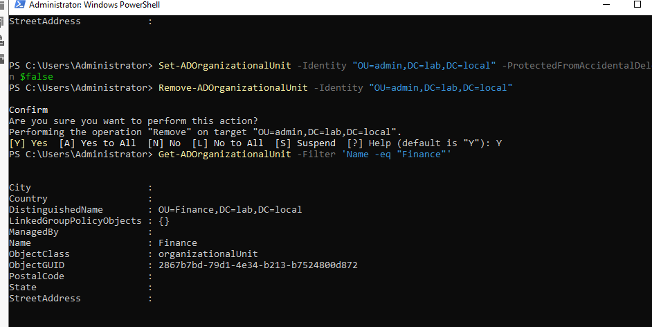

**Résultat :** `OU=Finance,DC=lab,DC=local`

### Étape 3 : créer le groupe de sécurité Finance Team

L'accès est donné à un **groupe**, pas à chaque personne (moindre privilège).

```powershell
New-ADGroup -Name "Finance Team" -GroupScope Global -GroupCategory Security -Path "OU=Finance,DC=lab,DC=local"
Get-ADGroup -Identity "Finance Team"
```
- Étendue **Global** : pour les utilisateurs de ce domaine.
- Catégorie **Security** : peut donner l'accès à des dossiers. Un groupe de distribution sert seulement aux courriels.

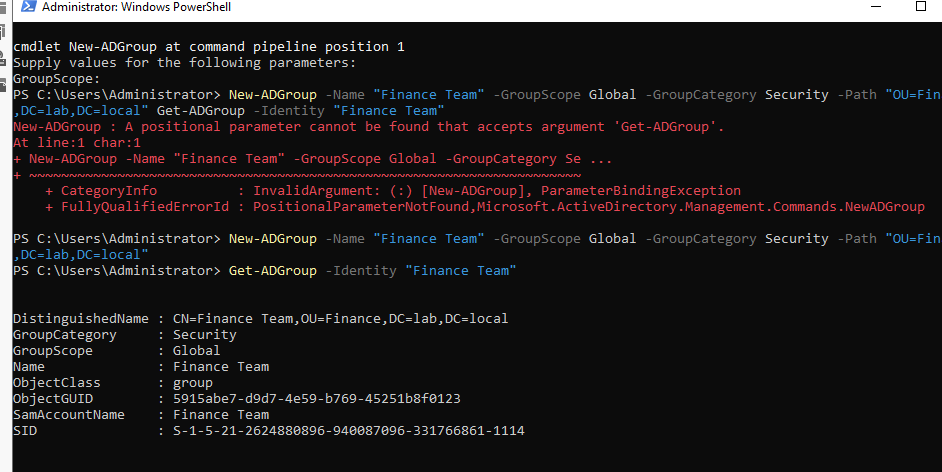

**Résultat :** `CN=Finance Team,OU=Finance,DC=lab,DC=local`, Security, Global.

### Étape 4 : créer l'utilisateur et donner l'accès par le groupe

```powershell
New-ADUser -Name "Sofia Martin" -GivenName "Sofia" -Surname "Martin" -SamAccountName "smartin" -UserPrincipalName "smartin@lab.local" -Path "OU=Finance,DC=lab,DC=local" -AccountPassword (Read-Host -AsSecureString "Temp password") -ChangePasswordAtLogon $true -Enabled $true
Add-ADGroupMember -Identity "Finance Team" -Members smartin
Get-ADGroupMember -Identity "Finance Team"
```
- Le mot de passe temporaire est tapé dans une invite masquée (`Read-Host -AsSecureString`). Il n'apparaît donc jamais à l'écran ni dans l'historique des commandes.
- `-ChangePasswordAtLogon $true` : l'utilisatrice choisit son propre mot de passe à la première connexion, pour que le service informatique ne le connaisse jamais.

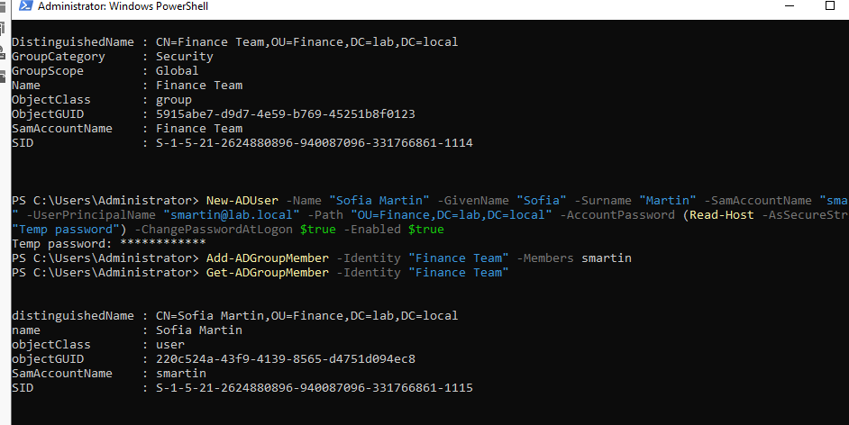

**Résultat :** Sofia Martin (smartin) est dans l'UO Finance et membre de Finance Team. ✅ Billet résolu.

### Étape 5 : le prouver dans le journal Sécurité

```powershell
Get-WinEvent -FilterHashtable @{LogName='Security'; Id=4720,4727,4728} -MaxEvents 10 | Format-Table TimeCreated, Id, TaskDisplayName -AutoSize
```
*Cherche ces 3 numéros d'événement dans le journal Sécurité.*

| Événement | Signification |
|---|---|
| 4727 | Un groupe global de sécurité a été créé |
| 4720 | Un compte d'utilisateur a été créé |
| 4728 | Un membre a été ajouté à un groupe global de sécurité |

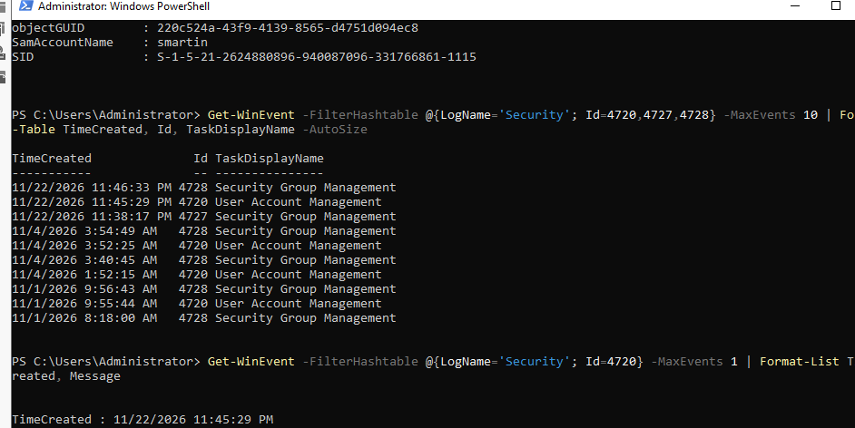

**Résultat :** mes trois actions apparaissent dans le bon ordre : **4727** à 23:38:17 (groupe), **4720** à 23:45:29 (utilisateur), **4728** à 23:46:33 (ajout au groupe). Les lignes plus anciennes sont mon travail précédent dans le labo, donc le journal garde l'historique.

```powershell
Get-WinEvent -FilterHashtable @{LogName='Security'; Id=4720} -MaxEvents 1 | Format-List TimeCreated, Message
```
*Ouvre tous les détails de la création d'utilisateur la plus récente.*

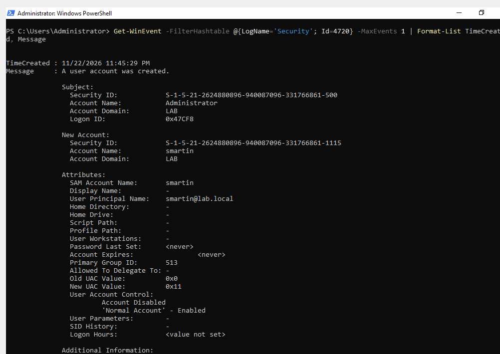

**Comment je le lis :**
- **Subject** = *qui l'a fait* : `Administrator`, domaine `LAB`. C'est la responsabilité (imputabilité) : le journal prouve qui a fait le changement.
- **New Account** = *ce qui a été créé* : `smartin`, UPN `smartin@lab.local`.
- **Account Disabled** à la création est normal : PowerShell crée d'abord le compte, puis l'active tout de suite après. Cela crée un autre événement (4722), qui fait partie de la mission 2.

---

## Problèmes et solutions

| # | Problème | Cause | Solution |
|---|---|---|---|
| 1 | `The term 'Mew-ADOrganizationlUnit' is not recognized` | Deux fautes d'orthographe dans le nom de la commande | Taper le début du nom et appuyer sur **Tab** pour que PowerShell le complète |
| 2 | PowerShell a demandé `Supply values for the following parameters: Name:`, et une UO **admin** non voulue a été créée | La commande a été lancée sans paramètres, et un nom a été tapé à l'invite | Retrait de la protection, puis suppression de l'UO (ci-dessous). Règle : écrire la commande complète sur une ligne; si l'invite apparaît, appuyer sur **Ctrl + C** |
| 3 | `Operator Not supported: -ep` | `-ep` tapé au lieu de `-eq` (égal) dans le filtre | Corrigé en `-eq` |
| 4 | `A positional parameter cannot be found that accepts argument 'Get-ADGroup'` | Deux commandes collées sur la même ligne, donc PowerShell a lu la deuxième comme une partie de la première | Une commande par ligne, ou les séparer avec `;` |

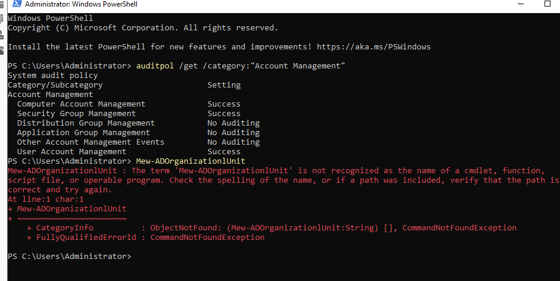
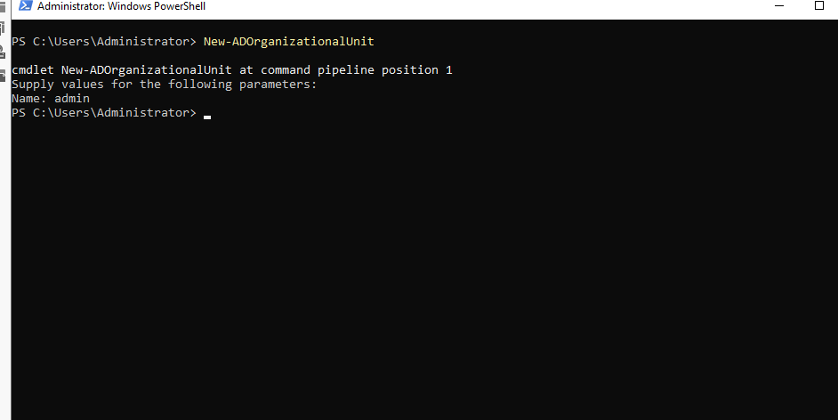

**Nettoyage de la mauvaise UO (problème 2).** Les nouvelles UO sont protégées contre la suppression accidentelle, il faut donc d'abord retirer la protection :

```powershell
Get-ADOrganizationalUnit -Filter 'Name -eq "admin"'
Set-ADOrganizationalUnit -Identity "OU=admin,DC=lab,DC=local" -ProtectedFromAccidentalDeletion $false
Remove-ADOrganizationalUnit -Identity "OU=admin,DC=lab,DC=local"
```
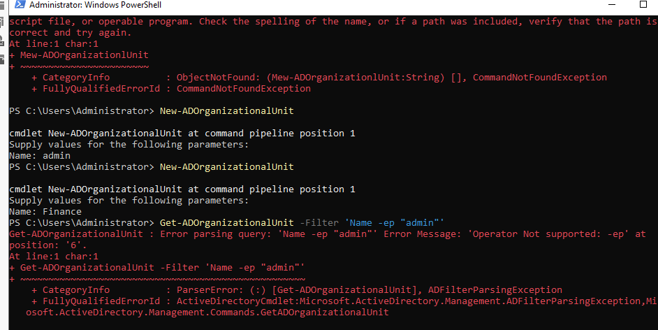
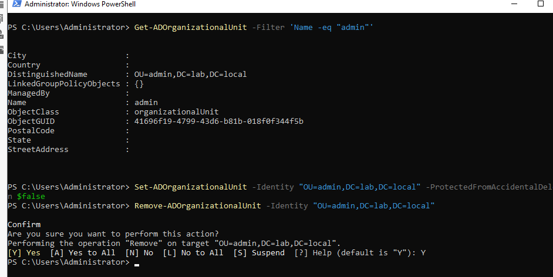
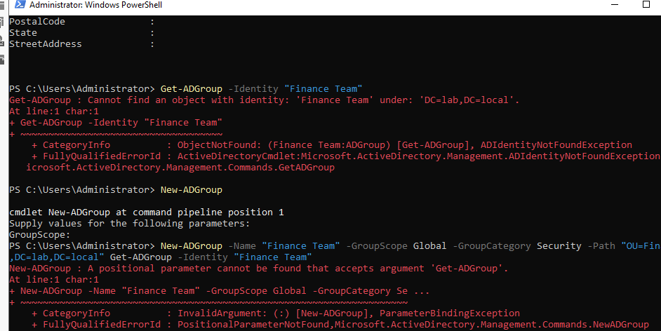

**Résultat final après les corrections :** la mauvaise UO est supprimée, et Finance, Finance Team et smartin sont tous corrects (étapes 2 à 4).

---

## Ce que j'ai appris
- Vérifier l'audit **avant** de faire des changements. Les journaux n'existent que si l'audit est activé.
- Donner l'accès par des **groupes** (moindre privilège) et forcer le changement de mot de passe à la première connexion.
- Chaque changement dans AD laisse une trace : **qui** (Subject), **quoi** (compte ou groupe visé) et **quand** (TimeCreated).
- Les erreurs PowerShell disent exactement ce qui ne va pas, à condition de les lire.
