# AD Lab Part 2: Running a Real Company with PowerShell

🇫🇷 [Version française](README.fr.md)
⬅️ [Back to Part 1: building the lab](../README.md)

Part 1 built the lab: domain **lab.local**, domain controller **DC01** (Windows Server 2022) and client **PC01** (Windows 11).
Part 2 runs it like a real IT department. Every change comes from a **ticket**, is done in **PowerShell**, and is then **proven in the Windows Security logs**. Later missions send these logs to **Splunk**.

| Mission | Ticket | Skills | Status |
|---|---|---|---|
| 1 | REQ-5001: new Finance department | OU, security group, user, group membership, audit policy, event IDs 4720 / 4727 / 4728 | ✅ Done |
| 2 | Coming next | Account enable/change events (4722, 4738), Event Viewer | ⏳ |
| 3 | Coming next | Splunk Universal Forwarder on DC01 | ⏳ |

---

## Mission 1: REQ-5001, new Finance department

> **Ticket (from HR):** "We're opening a Finance department. Create a Finance OU and a Finance Team group, and create the account for our new hire, Sofia Martin (smartin), with Finance access."

### Step 1: Check that the DC records account changes

Before changing anything, I made sure Windows writes these changes to the Security log. Without auditing, there is nothing to investigate later.

```powershell
auditpol /get /category:"Account Management"
```
*Shows which account changes are recorded (Success / Failure / No Auditing).*

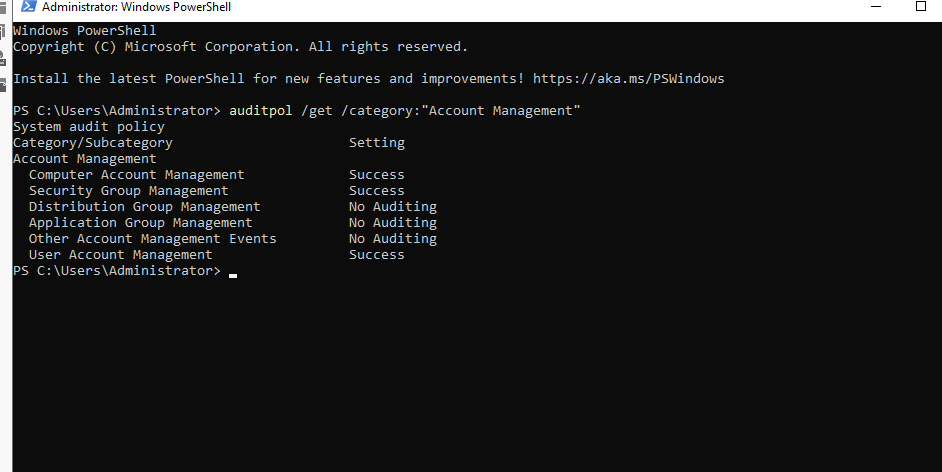

**Result:** **User Account Management** and **Security Group Management** are both set to **Success**, so user and group changes are logged.

### Step 2: Create the Finance OU

```powershell
New-ADOrganizationalUnit -Name "Finance" -Path "DC=lab,DC=local"
Get-ADOrganizationalUnit -Filter 'Name -eq "Finance"'
```
*Creates an OU (a folder in AD) for the Finance department, then checks where it is.*

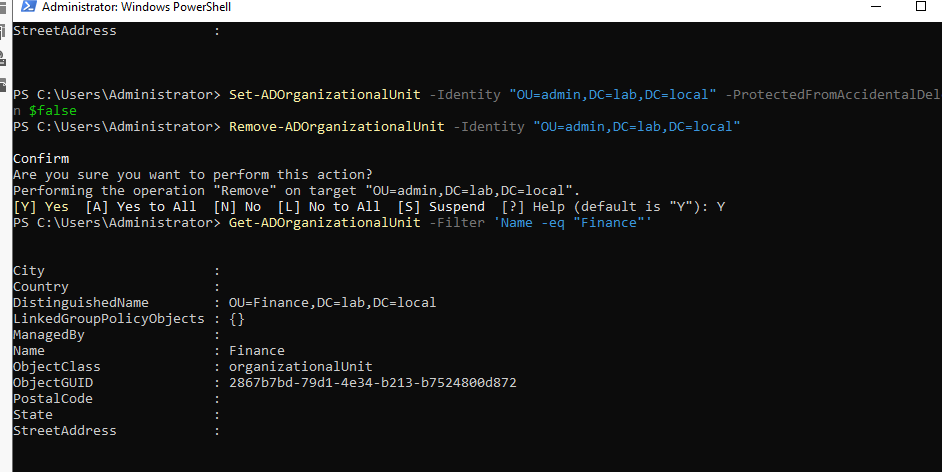

**Result:** `OU=Finance,DC=lab,DC=local`

### Step 3: Create the Finance Team security group

Access is given to a **group**, not to each person (least privilege).

```powershell
New-ADGroup -Name "Finance Team" -GroupScope Global -GroupCategory Security -Path "OU=Finance,DC=lab,DC=local"
Get-ADGroup -Identity "Finance Team"
```
- **Global** scope: for users of this domain.
- **Security** category: can give access to folders. A Distribution group is only for email.

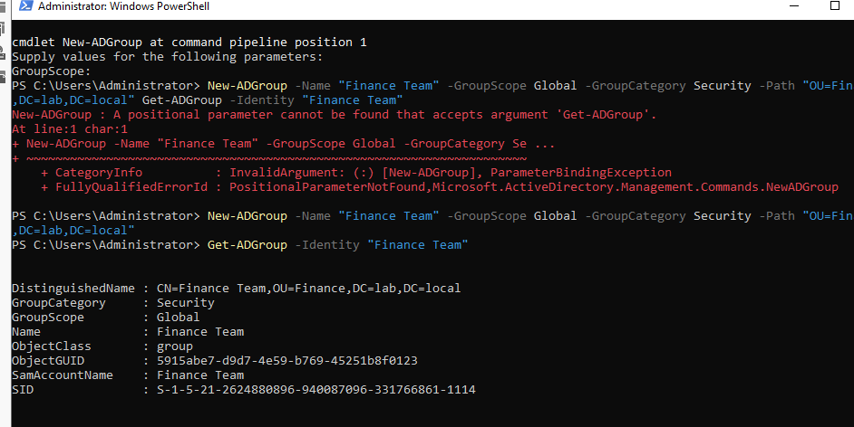

**Result:** `CN=Finance Team,OU=Finance,DC=lab,DC=local`, Security, Global.

### Step 4: Create the user and give access through the group

```powershell
New-ADUser -Name "Sofia Martin" -GivenName "Sofia" -Surname "Martin" -SamAccountName "smartin" -UserPrincipalName "smartin@lab.local" -Path "OU=Finance,DC=lab,DC=local" -AccountPassword (Read-Host -AsSecureString "Temp password") -ChangePasswordAtLogon $true -Enabled $true
Add-ADGroupMember -Identity "Finance Team" -Members smartin
Get-ADGroupMember -Identity "Finance Team"
```
- The temporary password is typed in a hidden prompt (`Read-Host -AsSecureString`), so it never appears on screen or in the command history.
- `-ChangePasswordAtLogon $true`: the user chooses her own password at first sign-in, so IT never knows it.

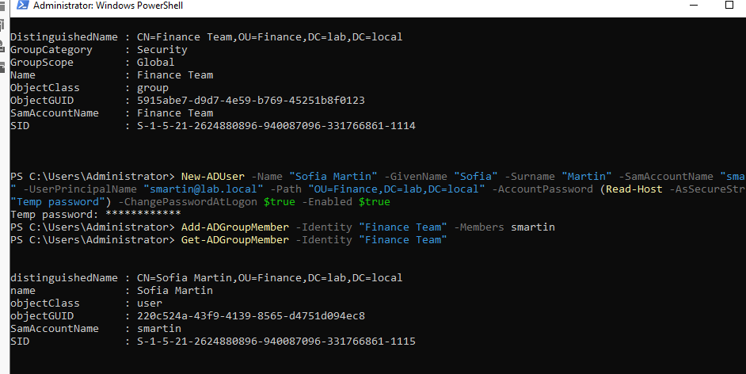

**Result:** Sofia Martin (smartin) is in the Finance OU and is a member of Finance Team. ✅ Ticket solved.

### Step 5: Prove it in the Security log

```powershell
Get-WinEvent -FilterHashtable @{LogName='Security'; Id=4720,4727,4728} -MaxEvents 10 | Format-Table TimeCreated, Id, TaskDisplayName -AutoSize
```
*Searches the Security log for these 3 event IDs.*

| Event ID | Meaning |
|---|---|
| 4727 | A security-enabled global group was created |
| 4720 | A user account was created |
| 4728 | A member was added to a security-enabled global group |

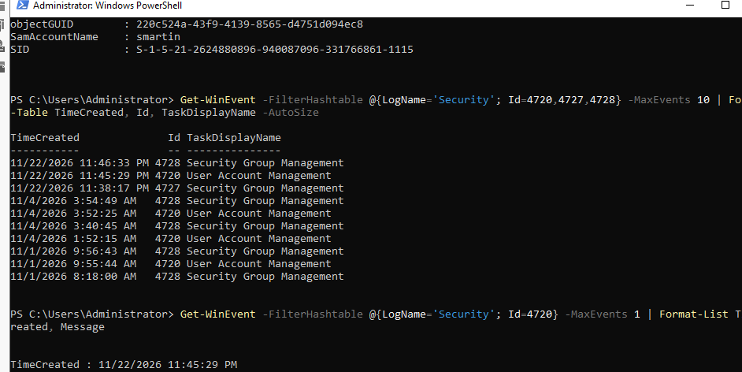

**Result:** my three actions appear in the right order: **4727** at 11:38:17 PM (group), **4720** at 11:45:29 PM (user), **4728** at 11:46:33 PM (added to group). The older lines are my earlier lab work, so the log keeps history.

```powershell
Get-WinEvent -FilterHashtable @{LogName='Security'; Id=4720} -MaxEvents 1 | Format-List TimeCreated, Message
```
*Opens the full details of the most recent user creation.*

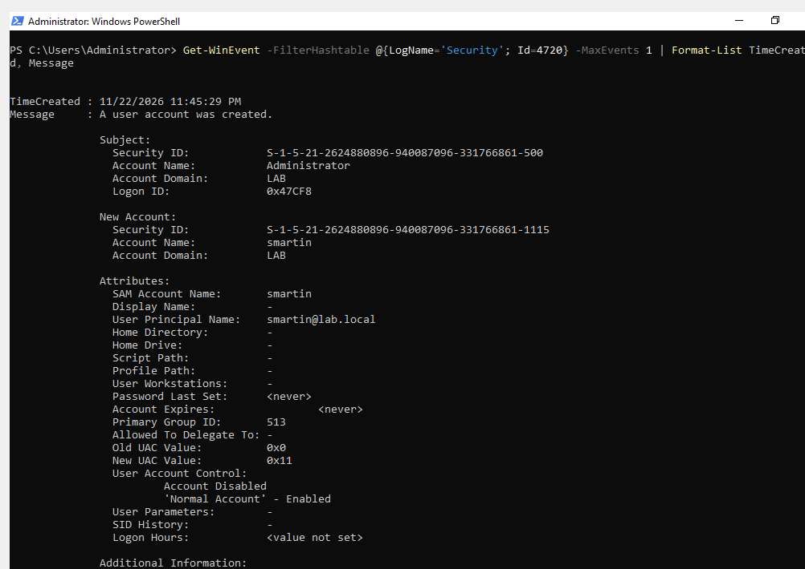

**How I read it:**
- **Subject** = *who did it*: `Administrator`, domain `LAB`. This is accountability: the log proves who made the change.
- **New Account** = *what was created*: `smartin`, UPN `smartin@lab.local`.
- **Account Disabled** at creation is normal: PowerShell creates the account first and enables it right after. That generates another event (4722), which is part of Mission 2.

---

## Issues and fixes

| # | Issue | Cause | Fix |
|---|---|---|---|
| 1 | `The term 'Mew-ADOrganizationlUnit' is not recognized` | Two spelling mistakes in the command name | Type the start of the name and press **Tab** so PowerShell completes it |
| 2 | PowerShell asked `Supply values for the following parameters: Name:`, and an unwanted OU **admin** was created | The command was run with no parameters, and a name was typed at the prompt | Removed the protection, then deleted the OU (below). Rule: write the full command on one line; if the prompt appears, press **Ctrl + C** |
| 3 | `Operator Not supported: -ep` | Typed `-ep` instead of `-eq` (equals) in the filter | Corrected to `-eq` |
| 4 | `A positional parameter cannot be found that accepts argument 'Get-ADGroup'` | Two commands pasted on the same line, so PowerShell read the second as part of the first | One command per line, or separate them with `;` |

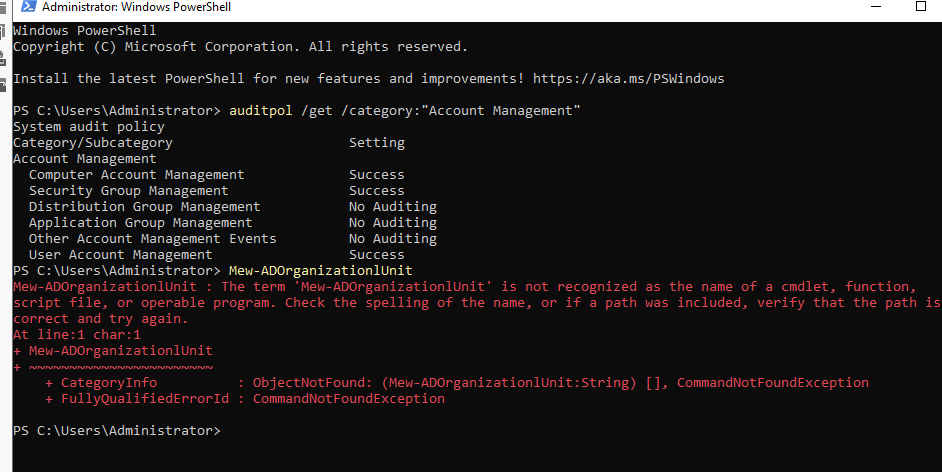
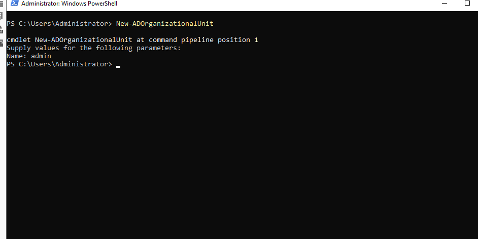

**Cleaning up the wrong OU (issue 2).** New OUs are protected from accidental deletion, so the protection has to be turned off first:

```powershell
Get-ADOrganizationalUnit -Filter 'Name -eq "admin"'
Set-ADOrganizationalUnit -Identity "OU=admin,DC=lab,DC=local" -ProtectedFromAccidentalDeletion $false
Remove-ADOrganizationalUnit -Identity "OU=admin,DC=lab,DC=local"
```
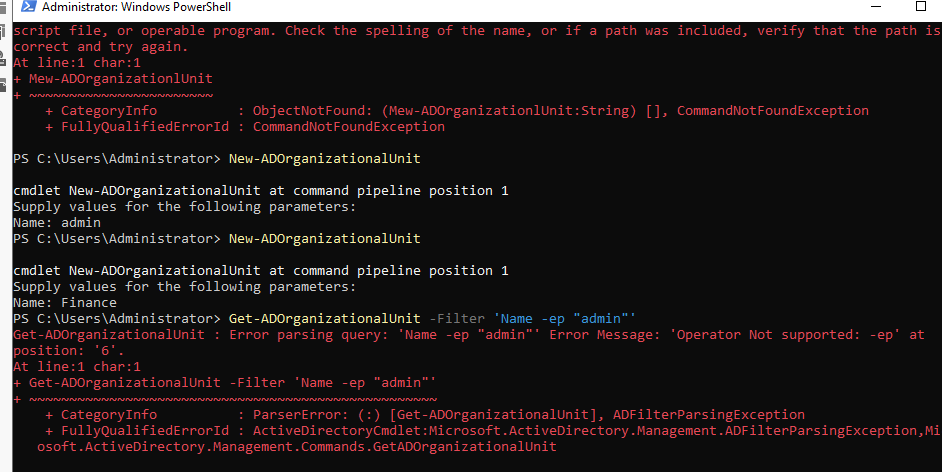
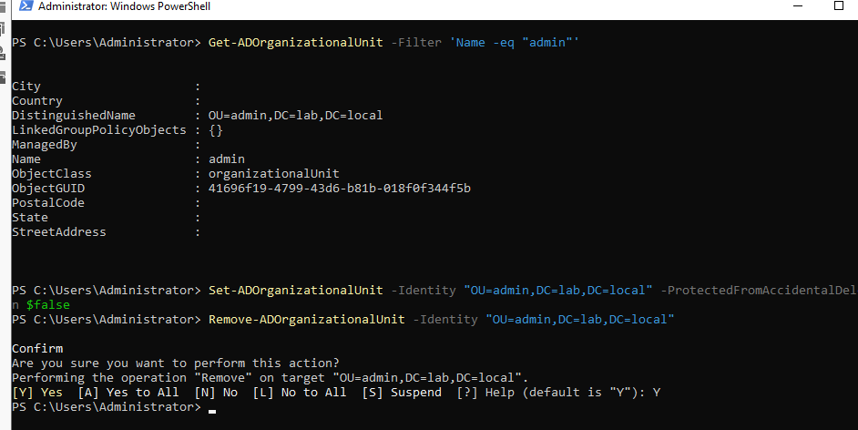
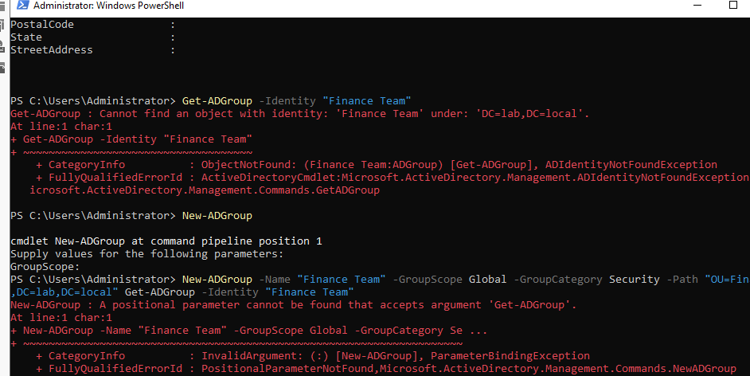

**Final result after the fixes:** the wrong OU is gone, and Finance, Finance Team and smartin are all correct (steps 2 to 4).

---

## What I learned
- Check auditing **before** making changes. Logs only exist if auditing is on.
- Give access through **groups** (least privilege), and force a password change at first logon.
- Every AD change leaves a trace: **who** (Subject), **what** (target account or group) and **when** (TimeCreated).
- PowerShell errors tell you exactly what is wrong if you read them.
